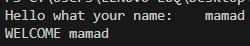
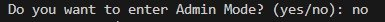
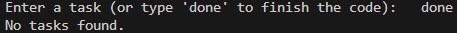

# Personal Task Manager

A simple command-line task manager built with Python. It allows users to manage tasks, set priorities, and save their tasks in a JSON file.

## Table of Contents

- [Description](#description)
- [Features](#features)
- [Project Structure](#project-structure)
- [Requirements](#requirements)
- [Installation](#installation)
- [Environment Setup](#environment-setup)
- [Usage](#usage)
- [Example Output](#example-output)
- [Screenshots](#screenshots)
- [Demo](#demo)
- [Roadmap](#roadmap)
- [Author](#author)

## Description

Personal Task Manager is a Python command-line application designed to help users organize and manage their daily tasks. Users can add new tasks, choose a priority, view their tasks, mark tasks as completed, and delete tasks.

Tasks are stored in JSON format so they can be loaded again when the program runs.

## Features

- Add new tasks
- Set task priorities: Low, Medium, and High
- View all tasks
- Complete tasks
- Delete tasks
- Save tasks in JSON format
- Admin Mode with password protection

## Project Structure

```text
personal_task_manager/
├── main.py
├── tasks.py
├── tasks.json
├── requirements.txt
├── .env.example
├── .gitignore
├── README.md
├── pictures/
│   ├── 1.png
│   ├── 2.png
│   └── 3.png
└── gifs/
    └── demo.gif
```

## Requirements

- Python 3.10 or newer
- python-dotenv

## Installation

1. Clone the repository:

   ```bash
   git clone https://github.com/amirali-sh88/personal_task_manager.git
   ```

2. Open the project folder:

   ```bash
   cd personal_task_manager
   ```

3. Install dependencies:

   ```bash
   pip install -r requirements.txt
   ```

## Environment Setup

Admin Mode uses an environment variable to store the admin password.

1. Create a file named `.env` in the project folder.
2. Add the following line:

   ```env
   TASK_MANAGER_ADMIN_PASSWORD=your_password_here
   ```

3. Replace `your_password_here` with your own password.
4. Never upload your real `.env` file or password to GitHub.
5. Use `.env.example` as a template for other users.

## Usage

Run the application:

```bash
python main.py
```

Enter your name when prompted. You can then choose whether to enter Admin Mode and use the menu to manage your tasks.

When adding a task, choose one of the following priorities:

- Low
- Medium
- High

## Example Output

```text
Enter your name: Amir
Welcome Amir

Personal Task Manager
1. Add Task
2. Show Tasks
3. Complete Task
4. Delete Task
5. Exit

Choose an option: 1
Enter task title: Study Python
Enter priority (Low/Medium/High): High
Task added.
```

The exact output may vary depending on the actions you choose.

## Screenshots

Add your screenshots to the `pictures/` folder.







## Demo

Place a GIF demonstrating the application in the `gifs/` folder.


## Roadmap

- [x] Create the basic task manager
- [x] Add task completion and deletion
- [x] Save tasks in JSON format
- [x] Add Admin Mode
- [x] Add task priorities: Low, Medium, and High
- [ ] Improve input validation
- [ ] Add more task management features

## Author

**AmirAli Sharifi**

GitHub: [amirali-sh88](https://github.com/amirali-sh88)
